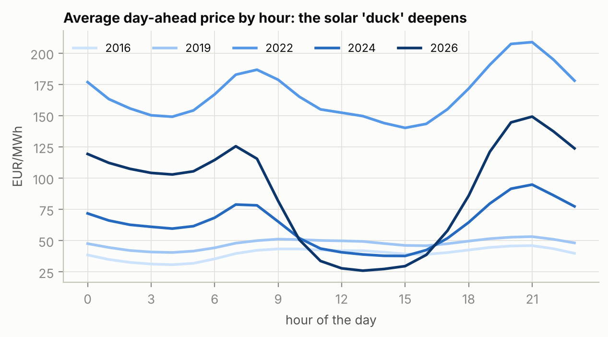
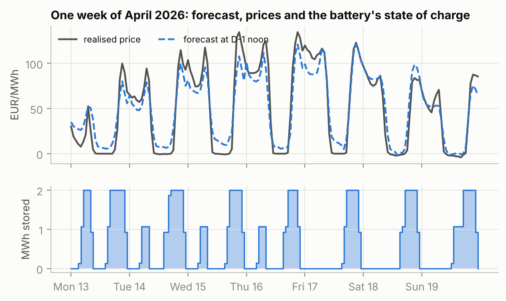
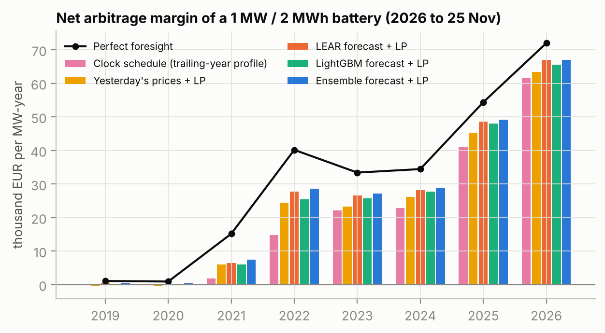
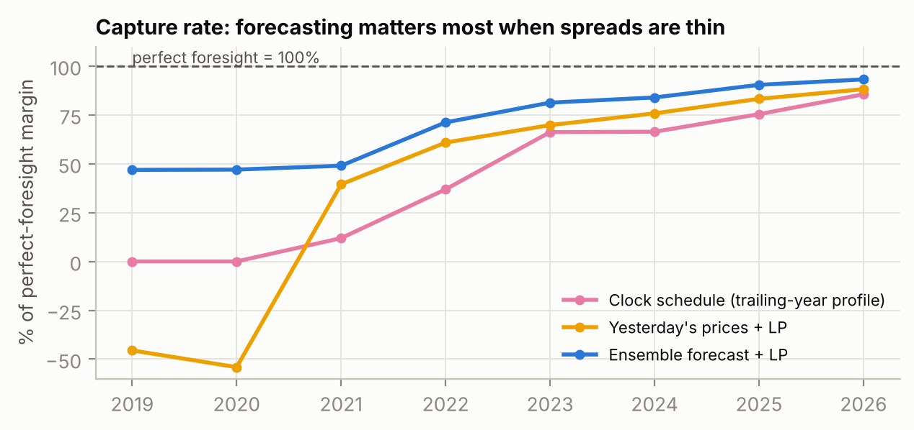
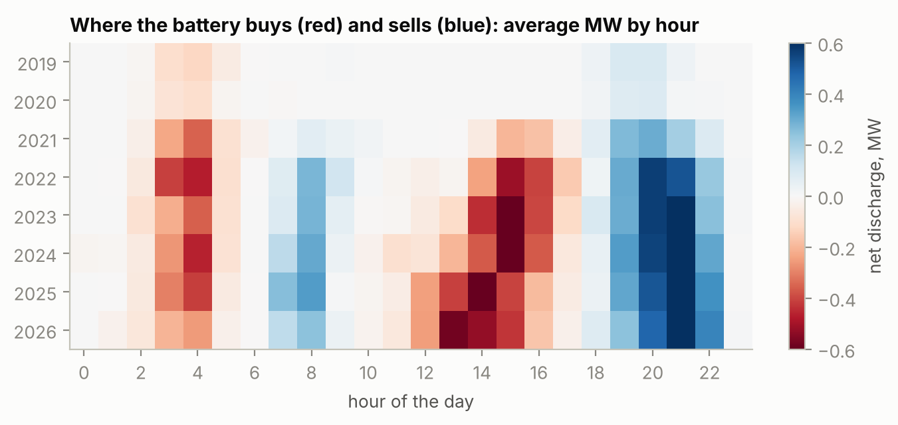
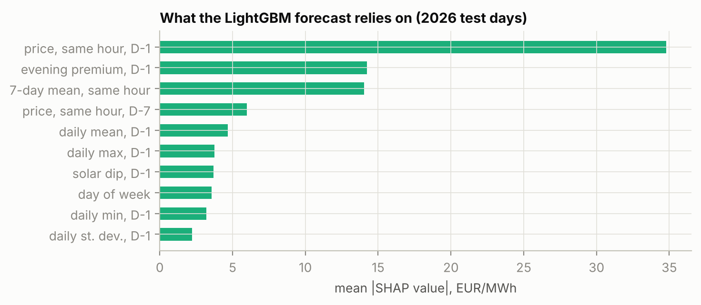
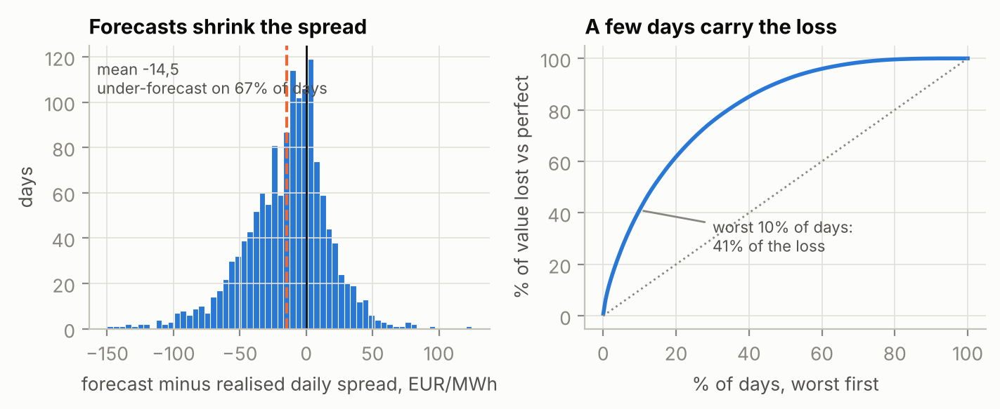
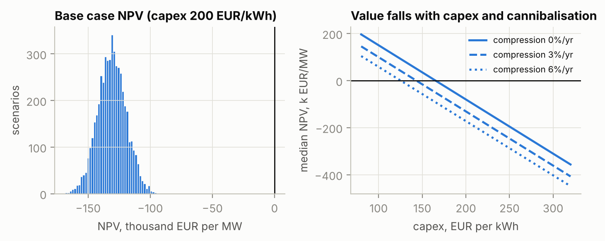

# What Is a Grid Battery Worth? Forecast-Driven Arbitrage, Reinforcement Learning and Valuation in the Spanish Day-Ahead Market

**Wassim Ibrahim** · AI for Finance, Prof. Josep Gisbert · Master in Finance, IE Business School · December 2026

## Abstract

Spain has 33 GW of solar capacity but, in mid-2025, only 18 MW of standalone batteries. Solar has turned the daily price curve into a deep "duck": prices collapse at midday and peak after sunset. This project asks how much a 1 MW / 2 MWh battery earns by arbitraging that curve in the day-ahead market, how much of the value depends on machine learning, and what that implies for an investor. I use 104.328 hourly prices, 2015 to November 2026. Four walk-forward forecasts (naive, LEAR, LightGBM and an ensemble) feed a linear programme that schedules the battery with full physics (efficiency, power and energy limits, wear). The schedule is settled at realised prices and compared with perfect foresight, a clock schedule and a tabular Q-learning agent. Over the 2019–2026 test period the ensemble captures 83,2% of the perfect-foresight margin, against 74,5% for yesterday's prices and 65,2% for the clock schedule. Diebold–Mariano tests on daily profits confirm every gain (t = 3,8–13,6). Across regimes the capture rate rises from 47% (2019–2020) to 89% (2023–2026) as solar widens spreads. In 2025 the battery earned €49.149 per MW net of wear. A Q-learning agent given the same forecast captures 77%, no better than the clock schedule. A Monte Carlo valuation shows that day-ahead arbitrage alone supports an installed cost of only €143–183 per kWh at a 10% cost of capital. Merchant batteries therefore pay at today's lowest global equipment prices, but not at typical European prices without other revenue streams.

## 1. Introduction and business problem

Electricity cannot be stored in the grid, so its price is set hour by hour. In Spain the day-ahead market (OMIE) fixes, at noon of day D−1, a price for every hour of day D. Solar plants now produce so much at midday that prices fall to zero or below on one hour in eight (12,1% of hours in 2026), while the average evening peak at 21:00 reached €149/MWh in 2026, against €26/MWh at 13:00 (Figure 1). The average gap between the most expensive and the cheapest hour of the day grew from €16,9/MWh in 2019 to €136,8/MWh in 2026. A battery buys the cheap hours and sells the dear ones, and that gap is its revenue.

The question is concrete and financial: **what is a 1 MW / 2 MWh battery worth to a merchant investor, and how much of that worth depends on forecasting?** The battery commits its schedule for day D at noon of D−1, before it knows D's prices. The profit it earns therefore depends on two things: the spread the market offers, and the quality of the forecast used to decide when to charge. The financial objective is the **net arbitrage margin** in euros per MW per year, after market fees and battery wear. The **capture rate** is that margin as a share of what perfect foresight would have earned. The investment decision is summarised by **NPV, IRR and the break-even capital cost** per kWh of storage.

**Why machine learning, and why this design.** The natural decision method is optimisation, because the battery's physics are known exactly and its decision is a constrained schedule. Machine learning enters where the uncertainty is: tomorrow's prices. This is a *predict-then-optimise* design (Elmachtoub and Grigas 2022). Each model must earn its place against simpler alternatives on two counts. The forecasts must beat yesterday's prices, and the forecast-driven schedule must beat a schedule set by the clock. As a second machine-learning approach, I test reinforcement learning, which learns a dispatch policy from rewards instead of optimising a model. The success metrics are economic rather than statistical. Forecast error matters only to the extent that it changes the money earned.

The project contributes three findings. First, a forecast ensemble adds a statistically significant 8,6 percentage points of capture over the naive forecast on the test period. Second, under known physics, explicit optimisation beats a learned RL policy by a wide margin. Third, the valuation turns the backtest into an investment rule: a break-even installed cost.

## 2. Data and methodology

### 2.1 Data

The data are the hourly prices of the Spanish day-ahead market, taken from Red Eléctrica's public REData API (series *Precio mercado spot*). They run from 1 January 2015 to 25 November 2026: 104.328 hours on 4.347 delivery days, downloaded on 24 November 2026. Since October 2025 the market clears in quarter-hours. I average these to hours, so the model ignores intra-hour arbitrage, which is a conservative choice. Daylight-saving days are normalised to 24 hours: the missing spring hour is interpolated and the repeated autumn hour is averaged, which is standard practice (Lago et al. 2021). The series has no gaps. It contains 2.648 hours at or below zero (1.572 strictly negative), all since 2022, which is why every model works with transformations that are robust to zero and negative prices. The 2022 series does not include the Iberian gas-cap adjustment that consumers paid on top of the spot price.

### 2.2 Decision timing and information set

The leakage rule follows the market calendar. **Every input to the decision for day D is known at noon of D−1.** At that moment the 24 prices of D−1 are known, because they were set at noon of D−2, and so are all earlier prices and the calendar of D. No feature uses a price of day D. Rolling statistics end at D−1. Holidays come from the official Spanish calendar, which is known in advance.

### 2.3 Battery model and optimal schedule

The battery has 1 MW of power and 2 MWh of usable energy, with a round-trip efficiency of 87% and an empty start and end each day. Each MWh traded pays a market fee of €0,5. Each MWh discharged also carries a wear cost of €15, which is the replacement value of the cells divided by their cycle life. Its role is to stop the optimiser from cycling for spreads that do not pay for the degradation they cause. For any price vector, the schedule maximises revenue minus fees minus wear, subject to the power limit, the energy limit and the state-of-charge balance. This is a linear programme with 73 variables, solved with HiGHS in milliseconds. **Every strategy uses the same optimiser and differs only in the prices it is given** (Table 1; Figure 2 shows one week).

**Table 1. Strategies compared.**

| Strategy | Prices given to the optimiser |
|---|---|
| Perfect foresight | realised prices of D (upper bound, not achievable) |
| Clock schedule | average hourly profile of the trailing 365 days, refreshed monthly |
| Naive D−1 / D−7 | yesterday's / last week's prices |
| LEAR, LightGBM, ensemble | walk-forward forecasts (Section 2.4) |

Each schedule is then **settled at realised prices**. The battery is assumed to be too small to move the price. This is reasonable while Spain has a few hundred megawatts of storage, but not forever (Section 4).

### 2.4 Forecasting models

- **LEAR** (LASSO-estimated autoregressive model) is the reference model of the electricity-price-forecasting literature (Lago et al. 2021). It fits one LASSO regression per hour on the 24 prices of D−1, D−2, D−3 and D−7, plus weekday and holiday dummies. The LASSO penalty is chosen by AIC. Prices are centred on the median, scaled by the median absolute deviation and transformed with asinh (Uniejewski, Weron and Ziel 2018). This handles negative prices and dampens spikes. The calibration window is the trailing two years.
- **LightGBM** gradient-boosted trees (Ke et al. 2017) are trained on a long table with one row per day and hour. The inputs are:
    - the same hour on D−1, D−2 and D−7, and its 7-day mean;
    - the hour's rank within D−1;
    - daily statistics of D−1 (mean, minimum, maximum, standard deviation, the midday "solar dip" and the evening premium);
    - hour, weekday, month and holiday flags.

    The loss is absolute error, which is robust to price spikes. The window expands over time.
- **Ensemble**: the simple average of the LEAR and LightGBM forecasts, fixed in advance with no weights estimated.

**Validation design.** All models are refitted at the start of each month on data before that month, an expanding or rolling walk-forward scheme. Hyperparameters were chosen on 2017–2018 only: the LEAR window (one, two or three years) and the LightGBM leaves, trees and learning rate. The test period, 1 January 2019 to 25 November 2026, is never used for any choice. Forecasts are scored with MAE, RMSE, MAE relative to the naive forecast, the error in the daily spread, and the Spearman rank correlation between forecast and realised hours. The last two matter because the battery profits from the *ordering* of hours, not from their level.

### 2.5 Reinforcement-learning agent

A tabular Q-learning agent (Watkins and Dayan 1992) chooses charge, idle or discharge at full power each hour. Its state has 1.800 combinations: the hour, the state-of-charge bucket, the quintile of the hour's *forecast* price within the day, and where that forecast stands among the hours still to come. The agent receives the **same ensemble forecast** as the optimiser, so the comparison isolates the decision method. The reward is the realised cash flow of the hour, net of fees and wear. For learning stability it is scaled by the day's price level. The agent trains on 2021–2023 with ε-greedy exploration that decays from 1 to 0,02 over 300 passes. It is then tested greedily on 2024 to November 2026.

### 2.6 Valuation

The valuation follows the infrastructure-investor convention: pre-tax, unlevered, a 15-year life, and a 10% cost of capital, which suits merchant risk (Ember 2025 uses 7% for contracted projects and 10–15% for merchant ones). Cash flows use the gross margin, before wear, because degradation is already in the capex, the life and a capacity fade of 2% per year. Charging wear as well would count it twice. Fixed O&M is 2% of capex per year (Ember 2025).

Revenues are simulated 5.000 times by bootstrapping calendar months of the ensemble's realised gross margin, which keeps the seasonal pattern. Two revenue windows are used: 2023–2026, and the recent wider-spread regime of 2025–2026. Margins then fall by 0%, 3% or 6% a year as storage builds out ("cannibalisation"). Capex runs from €120 to €280 per kWh:

- **€120/kWh** is close to the all-in global benchmark of about $125/kWh for October 2025 (Ember 2025).
- **€280/kWh** is close to BNEF's 2024 European turnkey average of $275/kWh, which excludes EPC and grid connection.

The outputs are the NPV distribution, the IRR and the break-even capex at which the median NPV is zero.

## 3. Empirical results

### 3.1 Forecast accuracy

Table 2 reports test-period accuracy. Every model beats yesterday's prices. LEAR is the best single model (MAE €14,51/MWh) and the ensemble is better still (€13,80/MWh, 18,5% below the naive €16,93/MWh). The ensemble also has the highest rank correlation, 0,838 against 0,740 for the naive forecast. It wins because the two models err differently: LEAR captures the linear structure of lags, and LightGBM captures interactions between weekday, holidays and the solar dip. Last week's prices are worse than yesterday's (€24,40/MWh), because the market changes faster than the weekly cycle.

**Table 2. Forecast accuracy, test period 2019 to 25 November 2026 (EUR/MWh).**

| Model | MAE | RMSE | rMAE vs D−1 | Spread MAE | Rank corr. |
|---|---|---|---|---|---|
| Yesterday's prices | 16,93 | 28,14 | 1,000 | 20,97 | 0,740 |
| Last week's prices | 24,40 | 39,22 | 1,441 | 24,02 | 0,771 |
| LEAR | 14,51 | 22,94 | 0,857 | 20,85 | 0,824 |
| LightGBM | 15,19 | 24,64 | 0,897 | 21,98 | 0,814 |
| **Ensemble** | **13,80** | **22,01** | **0,815** | **19,83** | **0,838** |

### 3.2 Economic value and significance

Table 3 converts the forecasts into money. Over the test period, perfect foresight would have earned €251.595 per MW net of fees and wear. The ensemble-driven battery earned €209.204, a **capture rate of 83,2%**. Yesterday's prices earned 74,5% and the clock schedule 65,2%. Accuracy and value are related, but they are not the same thing. Last week's prices have a 44% larger MAE than yesterday's, yet earn almost exactly the same (74,2% against 74,5%): they get the *ordering* of hours right more often (rank correlation 0,771 against 0,740), and ordering is what a battery trades. LEAR and LightGBM also differ in behaviour: LEAR cycles more and loses money on more days (11,5% against 6,4%).

**Table 3. Net margin and capture, test period 2019 to 25 November 2026.**

| Strategy | Net margin (EUR/MW) | Capture | Cycles/yr | Loss days |
|---|---|---|---|---|
| Perfect foresight | 251.595 | 100,0% | 350 | 0,0% |
| **Ensemble + LP** | **209.204** | **83,2%** | 316 | 7,6% |
| LEAR + LP | 205.042 | 81,5% | 359 | 11,5% |
| LightGBM + LP | 198.976 | 79,1% | 285 | 6,4% |
| Yesterday's prices + LP | 187.492 | 74,5% | 350 | 13,9% |
| Last week's prices + LP | 186.725 | 74,2% | 349 | 14,7% |
| Clock schedule | 164.119 | 65,2% | 232 | 8,4% |

The gain is statistically robust (Table 4). A Diebold–Mariano test on daily profit differences, with a Newey–West variance, rejects equal profitability between the ensemble and every alternative:

**Table 4. Diebold–Mariano tests on daily profit differences (Newey–West, 7 lags).**

| Ensemble vs | Gain per day | t-statistic |
|---|---|---|
| LEAR | €1,44 | 3,8 |
| LightGBM | €3,54 | 6,4 |
| Yesterday's prices | €7,52 | 13,0 |
| Clock schedule | €15,62 | 13,6 |

### 3.3 Robustness across regimes and designs

The test period spans three markets. Table 5 and Figures 3 and 4 show how each strategy fares in each.

**Table 5. Capture of perfect foresight by regime.**

| Regime | Ensemble | Yesterday's prices | Clock |
|---|---|---|---|
| 2019–2020, flat prices | 46,9% | −49,5% | 0,0% |
| 2021–2022, gas crisis | 65,1% | 55,0% | 30,0% |
| 2023–2026, solar era | 88,7% | 81,4% | 75,9% |

Before 2021 spreads were so thin (€1.097 per MW-year even with perfect foresight) that a naive schedule **lost money**: it paid efficiency losses and wear for spreads that did not materialise. The clock schedule stayed idle. The ML forecasts were the only ones to earn anything. In the gas crisis, volatile price levels made every forecast harder. In the solar era the daily shape became regular and deep, every strategy improved, and the gap between methods narrowed. **Forecasting is worth most when spreads are thin or irregular.** That is exactly the situation that cannibalisation will create as storage builds out. In 2025 the battery earned €49.149 per MW (90,4% capture). By 25 November 2026 it had earned €67.038 (93,1%).

Design sensitivity for 2023–2026, ensemble strategy:

**Table 6. Sensitivity to the battery's design, 2023–2026.**

| Change from the base case | Net margin (EUR per MW-year) | Effect |
|---|---|---|
| Base case: 2 h, 87% RTE, €15/MWh wear | 44.177 | reference |
| 4-hour battery | 74.964 | more per MW, but less per MWh of capacity (€18.741 vs €22.089) |
| 1-hour battery | 23.603 | about half the base case |
| Round-trip efficiency 92% | 48.236 | +9% |
| Round-trip efficiency 80% | 38.778 | −12% |
| No wear cost | 59.564 | cycles rise from 462 to 674 a year: the extra money is bought with degradation |

The capture rate stays between 84% and 92% in every case.

### 3.4 Reinforcement learning versus optimisation

On 2024 to November 2026 the Q-learning agent earned €124.035 per MW, a capture of 77,1%. That is **no better than the clock schedule (78,0%)** and well below the optimiser given the same forecast (90,2%, €145.088). The agent learned the shape of the day on its own: it charges at midday and sells in the evening. But it cannot reason about the exact energy and power limits, and its discretised state cannot tell a €20 spread from a €120 one at the same rank, so it trades the usual hours whether or not they pay (359 cycles a year against 469 for the optimiser). This matches the lesson of the course lab. When the physics are known and the agent does not move prices, optimisation dominates learned control. RL earns its place where no model of the environment exists, for example in intraday markets where prices arrive sequentially, or for a large battery whose trades move the price.

### 3.5 Interpretation and error analysis

SHAP values for the LightGBM model on 2026 test days (Figure 6) put the most weight on the same hour of D−1 (mean |SHAP| €34,8/MWh). Next come D−1's evening premium (€14,2) and the 7-day mean for the hour (€14,0). Calendar effects are small. The model has learned a persistence-plus-shape rule that an energy trader would recognise. The dispatch heat map (Figure 5) shows the strategy migrating: in 2019–2021 the battery charged around 3–5 a.m. and sold in the evening. From 2022 the main charge moves to 13–16 h, when solar collapses prices, with a second trade from night to the morning peak.

Where is value lost? In the solar era the forecasts **shrink the spread**: the forecast daily spread is €14,5/MWh below the realised one on average, and too small on 67% of days. The losses are also concentrated: the worst 10% of days account for 41% of the value lost against perfect foresight (Figure 7). These are days with extreme solar collapses or evening spikes, which a model trained to minimise average error smooths away. This points to the natural next step: train the forecaster on decision value rather than on MAE (Elmachtoub and Grigas 2022).

### 3.6 What is the battery worth?

Using the 2023–2026 revenue window, the median simulated first-year gross margin is €55.104 per MW (P10 €47.511, P90 €63.818). With the 2025–2026 window it is €71.043. Table 7 and Figure 8 summarise the investment case.

**Table 7. Valuation of a 1 MW / 2 MWh merchant battery (15 years, 10% WACC, 3% annual margin compression unless stated).**

| Revenue window | Capex €/kWh | Median NPV (EUR/MW) | Median IRR | Break-even capex |
|---|---|---|---|---|
| 2023–2026 | 120 | +53.399 | 14,4% | €143/kWh |
| 2023–2026 | 200 | −130.940 | 2,8% | €143/kWh |
| 2025–2026 | 120 | +145.568 | 21,5% | €183/kWh |
| 2025–2026 | 200 | −38.771 | 8,0% | €183/kWh |
| 2025–2026, no compression | 200 | +26.405 | 11,2% | €211/kWh |
| 2023–2026, 6% compression | 120 | +12.087 | 11,1% | €125/kWh |

The bootstrap spread is narrow (P10–P90 of about €30.000 per MW) because monthly noise averages out over 15 years. **The real risk is the regime: the revenue window and the speed of cannibalisation, not month-to-month luck.** The investment rule is clear. Day-ahead arbitrage alone justifies an installed cost of roughly **€125–210 per kWh**, depending on how long today's spreads last. At the lowest current global prices a merchant battery clears a 10% hurdle in every scenario tested. At typical European 2-hour costs it does not, unless the 2025–2026 spreads persist undiminished or other revenues are added. Those revenues include ancillary services and Spain's planned capacity market, which offers contracts of up to 15 years for new storage (Modo Energy 2026).

## 4. Conclusion and implementation risks

A forecast-driven battery in the Spanish day-ahead market captured 83% of the theoretically available arbitrage between 2019 and November 2026, and 89% in the solar era. A simple, interpretable ensemble of LEAR and gradient boosting beats naive forecasts by a significant margin, and its value is largest when spreads are thin. Reinforcement learning, given the same information, did not beat a clock schedule: in this problem, physics-aware optimisation is the right tool. The valuation turns these results into a purchase-price discipline for investors. The battery is worth buying if it can be installed for less than about €140–180 per kWh on arbitrage alone.

**Implementation risks.**

1. **Price impact and cannibalisation.** Settlement assumes a price-taker. As gigawatts of storage chase the same hours, spreads will compress. The valuation stresses this at up to 6% a year, but faster compression is possible.
2. **Overfitting and regime change.** Hyperparameters were fixed on 2017–2018 and all models are refitted monthly. Still, the most profitable years are also the most recent, so the revenue window drives the valuation (Table 7).
3. **Data limitations.** Prices only: no wind, solar or demand forecasts, which a desk would buy and which would likely raise capture further. Quarter-hour prices are averaged to hours. The 2022 prices exclude the Iberian gas-cap adjustment.
4. **Operational constraints.** Warranties cap daily cycles and depth of discharge. Augmentation costs arrive in years 2–5, and route-to-market fees reduce margins (López Martín, Energy-Storage.news). The wear cost and 2% fade only approximate these.
5. **Computational cost** is trivial: a full run takes about six minutes on a laptop or in Colab, so the model can be refitted daily.
6. **Regulation.** Storage pays grid access charges and faces evolving rules on capacity payments. The bidding strategy must also comply with REMIT market-abuse rules.

## References

Diebold, F. X. and Mariano, R. S. (1995). Comparing predictive accuracy. *Journal of Business & Economic Statistics*, 13(3), 253–263.
Elmachtoub, A. N. and Grigas, P. (2022). Smart "predict, then optimize". *Management Science*, 68(1), 9–26.
Ember (2025). *How cheap is battery storage?* K. Rangelova and D. Jones, 11 December 2025.
Energy-Storage.news (2025). Behind the numbers: BNEF finds 40% year-on-year drop in BESS costs.
Ke, G. et al. (2017). LightGBM: a highly efficient gradient boosting decision tree. *Advances in Neural Information Processing Systems*, 30.
Lago, J., Marcjasz, G., De Schutter, B. and Weron, R. (2021). Forecasting day-ahead electricity prices: a review of state-of-the-art algorithms, best practices and an open-access benchmark. *Applied Energy*, 293, 116983.
López Martín, I. Spain's BESS pipeline is real: the PE models are wrong. *Energy-Storage.news*.
Lundberg, S. M. and Lee, S.-I. (2017). A unified approach to interpreting model predictions. *Advances in Neural Information Processing Systems*, 30.
Modo Energy (2025). Iberia: why are there no batteries in Spain? P. Martinez, 3 June 2025.
Modo Energy (2026). Spain's upcoming capacity market: what we know so far. P. Brito, 27 January 2026.
Newey, W. K. and West, K. D. (1987). A simple, positive semi-definite, heteroskedasticity and autocorrelation consistent covariance matrix. *Econometrica*, 55(3), 703–708.
Sioshansi, R., Denholm, P., Jenkin, T. and Weiss, J. (2009). Estimating the value of electricity storage in PJM: arbitrage and some welfare effects. *Energy Economics*, 31(2), 269–277.
Uniejewski, B., Weron, R. and Ziel, F. (2018). Variance stabilizing transformations for electricity spot price forecasting. *IEEE Transactions on Power Systems*, 33(2), 2219–2229.
Watkins, C. J. C. H. and Dayan, P. (1992). Q-learning. *Machine Learning*, 8, 279–292.

## Annex A. Reproducibility and use of generative AI

All results are reproduced by the Colab notebook `capstone_bess_spain.ipynb` and the GitHub repository. Running the notebook top to bottom rewrites every table (`results/t1`–`t10`) and figure (`results/figures/f1`–`f8`). Every number quoted in the text is in `results/key_numbers.json`. The data are stored in the notebook and can be refreshed from the public REE API with `bess.data.download_ree()`.

**Generative AI.** Claude (Anthropic) was used as a coding and drafting assistant: implementing the pipeline, producing the figures, and editing the text. I specified the research design, checked every result against the code output, and take full responsibility for the methodology, results and interpretation.
